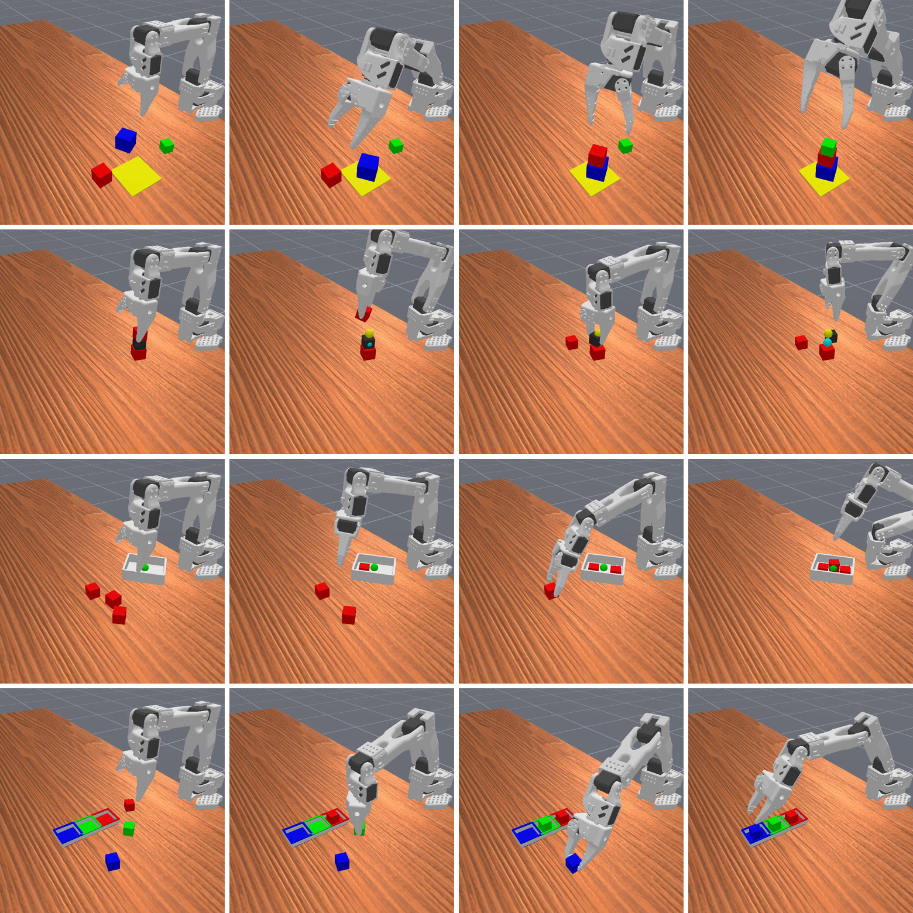

# Squinting Harder

*Teaching a $100 robot arm a long, multi-stage task from a 16×16 pixel camera, with flow matching, Q-chunking, and one small change to the critic.*

---

### Flow matching in one paragraph

Flow matching is a way to **generate data by moving noise toward real samples**. You train a neural network $v_\theta(x, t)$ to be a *velocity field*: given a point $x$ and a time $t \in [0, 1]$, it says which way to move. Start from Gaussian noise $x^0 \sim \mathcal{N}(0, I)$ and follow that velocity (solve the ODE $\tfrac{dx}{dt} = v_\theta(x, t)$) from $t=0$ to $t=1$. If training went well, the point you end at, $x^1$, looks like it came from your data.

The line that sums it up:

> Transform a noise sample $x^0 \sim p$ into a sample $x^1 = \psi(x^0)$ such that $x^1 \sim q$, the data distribution.

The training trick is what makes it cheap. Learning the full transport between two distributions is hard, so we **condition on one data sample at a time**. Pick a real sample $x^1$, pick noise $x^0$, and draw a straight line between them:

$$x^t = (1-t)\,x^0 + t\,x^1$$

Along that line the "ideal" velocity is just $x^1 - x^0$. So the loss is a plain regression:

$$\mathcal{L}_\text{FM} = \big\| v_\theta(x^t, t) - (x^1 - x^0) \big\|^2$$

Average over many samples and the network learns a velocity field that carries the whole noise distribution onto the whole data distribution.

### Flow matching for robots

In robotics, the "data" is **actions**. The policy gets an observation $s$ (camera image, joint angles), starts from a random noise vector, and integrates the flow, conditioned on $s$, until the noise becomes an action. Flow policies are popular because they can represent **multi-modal** behavior (go left around the cube *or* right) where a Gaussian policy would average the two and hit the cube.

### Flow Q-Learning (FQL): adding a critic

A flow policy trained this way is pure **behavior cloning**: it copies the dataset. It is no better than the demos. To do better we need reinforcement learning: a **critic** $Q(s, a)$ that scores actions, and a policy that climbs it.

Doing RL directly through a 10-step ODE solver is expensive and unstable (you'd backprop through every step). **Flow Q-Learning** (Park, Li & Levine, 2025) avoids that with three networks:

1. **Flow BC policy** $v_\theta$: trained with the flow-matching loss above on dataset actions. It models *what the demos do*.
2. **Critic** $Q_\phi(s, a)$: trained with temporal-difference learning (minimize the Bellman error against a target network).
3. **One-step policy** $\mu_\omega(s, z)$: maps noise $z$ straight to an action in a *single* forward pass. Its loss has two parts:

$$\mathcal{L}_\mu = \underbrace{\alpha \, \big\| \mu_\omega(s,z) - \text{flow}_\theta(s,z) \big\|^2}_{\text{stay close to the demos}} \;-\; \underbrace{Q_\phi\big(s, \mu_\omega(s,z)\big)}_{\text{but get high value}}$$

So the expensive multi-step flow is **distilled** into a fast one-step network, and the critic pushes that network toward better actions without letting it drift too far from the data (out-of-distribution actions are where critics lie). At deployment you only run $\mu_\omega$, which is one MLP call.

### Q-Chunking (QC-FQL): predict several steps at once

**Q-chunking** (Li, Zhou & Levine, 2025) changes one thing: instead of one action, the policy outputs a **chunk of $h$ actions** $a_{t:t+h}$. The robot executes the chunk open-loop, then asks again. The critic scores whole chunks, and its target becomes an $h$-step backup:

$$y_t = \sum_{k=0}^{h-1} \gamma^k r_{t+k} \;+\; \gamma^h \, \bar Q\big(s_{t+h}, \pi(s_{t+h})\big)$$

The pitch for long-horizon tasks is that reward propagates back $h$ steps per update instead of one, and exploration is temporally coherent (the arm commits to a motion for $h$ steps instead of jittering). It also runs **offline-to-online**: pretrain on demos, then keep collecting live experience into a replay buffer $\mathcal{D}$ and keep updating all three networks.

That's all the theory you need. Now for what I actually did.

---

## 2. What I did

### The starting point: Squint

I came across **[Squint](https://arxiv.org/abs/2602.21203)** (Almuzairee & Christensen, 2026). It trains a visual SAC policy for the low-cost **SO-101** arm from a **16×16 wrist-camera image** plus joint angles, in minutes of GPU time in simulation (ManiSkill 3), and then transfers it to the real arm. A 16×16 image is tiny, about 256 pixels, and it still works.

But Squint's tasks are **short and single-stage**: lift a cube, stack a cube, about 50 control steps. I wanted to know whether it scales to **long-horizon, multi-stage** tasks. So the first step was to build those tasks.

### ManiBench-LH: four long-horizon tasks

I added four multi-stage tasks for the SO-101:

- **Tower3:** build a tower from three cubes of different sizes, largest at the bottom.
- **Unstack3:** take a three-cube tower apart: top cube to the table, then the middle one, leaving the base in place.
- **Place3:** like Squint's place-in-bin task, but with three cubes and three bins.
- **TrayPack3:** place three cubes into their compartments in a tray.

### Attempt 1: plain Squint. It doesn't work.

I ran the original Squint SAC on these tasks with the same observations and the same evaluation (64 fixed episodes). In 2M environment steps it never solved any of them reliably. Its best was **0.11** on Unstack3, and it scored **0.00** on the other three.

This is exactly the situation QC-FQL was built for. It starts from demonstrations and improves them with RL.

### Step 1: get demonstrations, and make them messy on purpose

QC-FQL needs a dataset. I wrote a **scripted motion planner** for the SO-101 (custom inverse kinematics, with grasp checks and retries) that solves each task and records the trajectory **in exactly the policy's format**: the same 16×16 camera, the same 12-d state, the same normalized delta actions, the same reward. Every demo is then **replayed** from its seed to check it reproduces exactly and ends in success. 500 demos take about 5 minutes on CPU.

My first version recorded *clean* demos, and the policy learned the wrong lesson. In the eval videos, after a missed grasp, it kept going and carried **nothing** to the target. It had memorized the *motion sequence*, not *"is the cube actually in my hand?"*

So I made the demos **recovery demos**:

- **Action noise (σ = 0.2)** is added to the arm while it follows the planned path, and the planner **re-plans from wherever the arm actually ended up**. The data now contains corrections.
- **Deliberate misses**: with probability 0.3, the first grasp closes one cube-height too high. The grasp check notices, the arm backs off, and it re-grasps.
- The dataset stores the **actions actually executed**, so every (observation, action) pair is something that really happened.

### Step 2: QC-FQL on all four tasks

I implemented QC-FQL inside the Squint framework. I kept Squint's small CNN, its 16×16 wrist image, and its 1,024 parallel simulated environments. The policy is pretrained offline on the recovery demos and then trained online, with each batch half demos and half fresh experience. Then I evaluated it on all four tasks:

| Task | Squint (baseline) | QC-FQL (ours) |
|---|---|---|
| Unstack3 | 0.11 | **0.91** |
| TrayPack3 | 0.00 | **0.13** |
| Place3 | 0.00 | **0.23** |
| Tower3 | 0.00 | **0.11** |

QC-FQL beats the baseline on every task. Unstack3 is close to solved. The other three are no longer at zero, but there's still a long way to go: the policy usually gets the first cube right and loses it on the later ones. We evaluated the unstack3 task on the real robot and yeah it works.

<figure>
  <video src="assets/unstack3.mp4" controls autoplay muted loop playsinline preload="metadata"></video>
  <figcaption>QC-FQL solving Unstack3: top cube to the table, then the middle one, base left in place.</figcaption>
</figure>

## 3. Conclusion

Squint showed that a tiny 16×16 wrist image is enough to learn short tasks. On its own, though, it can't get through a long, multi-stage one: random exploration almost never reaches the reward at the end. Adding demonstrations and QC-FQL changed that. On my four long-horizon tasks, success went from almost zero to **0.91 on Unstack3**, with real progress on TrayPack3, Place3 and Tower3.

That's what the title means. The robot didn't get better eyes: it still sees the world through the same 16×16 pixels. It just squints harder, getting more out of the same tiny image by learning from demonstrations and by trusting a critic that judges whole stretches of actions. And the critic is the part that matters most. The flow policy can only copy the demos; the **critic** is what tells it how to do better. When the critic's values were wrong, the policy got worse. When the critic was right, everything else worked.

---

### References

- Almuzairee & Christensen, *Squint*, 2026. [arXiv:2602.21203](https://arxiv.org/abs/2602.21203)
- Park, Li & Levine, *Flow Q-Learning*, 2025.
- Li, Zhou & Levine, *Reinforcement Learning with Action Chunking* (Q-chunking), 2025.
- Lipman et al., *Flow Matching for Generative Modeling*, 2023.
- Fujimoto et al., *Addressing Function Approximation Error in Actor-Critic Methods* (TD3, clipped double-Q), 2018.
- ManiSkill 3; LeRobot SO-101.
